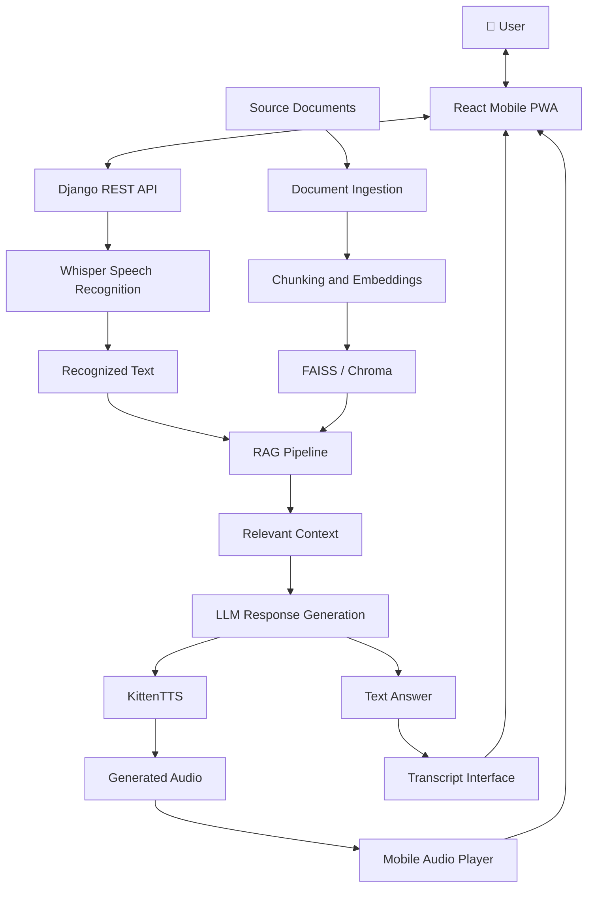

# 🎙️ NexaSpeak AI

### Speak Beyond Limits. Think Beyond Boundaries.

<p align="center">
  <b>A Mobile-Based Intelligent Voice Assistant Powered by Generative AI and RAG</b>
</p>

<p align="center">
  An intelligent voice assistant that listens, understands, retrieves knowledge, and responds through natural-sounding speech.
</p>

<p align="center">
  
</p>

<p align="center">
  
  
  
  
  
</p>

---

## 📱 About NexaSpeak AI

**NexaSpeak AI** is a mobile-oriented conversational AI application designed to make information accessible through natural voice interactions.

Users can speak questions, view speech transcripts, retrieve relevant information from documents, receive AI-generated answers, and listen to spoken responses.

The application combines speech recognition, Retrieval-Augmented Generation (RAG), semantic search, a Large Language Model (LLM), and text-to-speech technology in a unified interface.

The proposed application uses a **Progressive Web App (PWA)** architecture, allowing users to install it on supported mobile devices without initially requiring a native Android application.

## ✨ Key Features

<table>
<tr>
<td width="50%">

### 🎤 Voice Interaction
Ask questions using the device microphone.

</td>
<td width="50%">

### 📝 Speech Recognition
Convert spoken questions into text using Whisper.

</td>
</tr>
<tr>
<td>

### 🧠 Intelligent Responses
Generate contextual answers using an LLM.

</td>
<td>

### 📚 Document-Based Knowledge
Retrieve relevant information from uploaded documents using RAG.

</td>
</tr>
<tr>
<td>

### 🔊 AI Voice Output
Listen to generated answers using KittenTTS.

</td>
<td>

### 📲 Mobile-Friendly Interface
Use an installable, responsive PWA.

</td>
</tr>
<tr>
<td>

### 🔎 Semantic Search
Find relevant document passages using vector similarity.

</td>
<td>

### 💬 Conversation Interface
View transcripts and play generated audio responses.

</td>
</tr>
</table>

## 🏗️ System Architecture



## 🔄 How NexaSpeak AI Works

<p align="center">
  <b>Voice Input → Speech Recognition → Knowledge Retrieval → AI Response → Voice Output</b>
</p>

### 1. 🎤 Voice Input
The user speaks a question through the mobile device's microphone.

### 2. 📝 Speech-to-Text
Whisper processes the recorded audio and converts it into text.

### 3. 📚 Knowledge Retrieval
The RAG pipeline searches a vector database for relevant information from indexed documents.

### 4. 🧠 AI Response Generation
The retrieved context and recognized question are provided to the configured LLM to generate a relevant answer.

### 5. 🔊 Text-to-Speech
KittenTTS converts the generated text into audio.

### 6. 📱 Response Delivery
The mobile interface displays the answer, presents the transcript, and allows the user to play the generated speech.

## 🛠️ Technology Stack

| Component | Technology | Purpose |
|---|---|---|
| Mobile Interface | React, JavaScript, CSS | Responsive application UI |
| Application Platform | PWA | Installable mobile experience |
| Backend | Python, Django REST Framework | API and business logic |
| Speech Recognition | Whisper | Audio transcription |
| Embedding Model | Configurable embedding model | Text vector generation |
| Vector Database | FAISS or Chroma | Semantic document retrieval |
| AI Engine | Configurable LLM | Contextual response generation |
| Text-to-Speech | KittenTTS | Spoken response generation |
| API Communication | HTTP/REST | Frontend-backend integration |
| Configuration | Environment variables | Manage application settings |
| Version Control | Git and GitHub | Source code management |

## 📂 Project Structure

```text
NexaSpeak-AI/
│
├── frontend/
│   ├── public/
│   │   ├── manifest.json
│   │   ├── service-worker.js
│   │   └── icons/
│   │
│   ├── src/
│   │   ├── components/
│   │   │   ├── MicButton.jsx
│   │   │   ├── TranscriptBox.jsx
│   │   │   └── AudioPlayer.jsx
│   │   ├── hooks/
│   │   │   └── useRecorder.js
│   │   ├── services/
│   │   │   └── api.js
│   │   ├── App.jsx
│   │   └── main.jsx
│   │
│   └── package.json
│
├── backend/
│   ├── manage.py
│   ├── requirements.txt
│   ├── config/
│   │   ├── settings.py
│   │   └── urls.py
│   │
│   ├── voice/
│   │   ├── views.py
│   │   ├── urls.py
│   │   └── services/
│   │       ├── stt_service.py
│   │       └── tts_service.py
│   │
│   ├── rag/
│   │   ├── ingest.py
│   │   ├── embeddings.py
│   │   ├── retriever.py
│   │   ├── llm.py
│   │   └── pipeline.py
│   │
│   └── data/
│       ├── documents/
│       └── vector_store/
│
├── assets/
│   ├── nexaspeak-banner.png
│   └── screenshots/
│
├── .env.example
├── .gitignore
└── README.md
```

*This is the proposed structure. Adapt it to the files actually implemented in your repository.*

## 🎨 Mobile Application Preview

Add your actual application screenshots to the repository as development progresses.

| Voice Assistant | AI Response |
|---|---|
| `assets/screenshots/home-screen.png` | `assets/screenshots/response-screen.png` |
| Microphone, greeting, and voice controls | Answer transcript and audio playback |

Recommended screens:

- 🏠 Home screen with microphone button
- 🎙️ Recording and listening screen
- 💬 Conversation and transcript screen
- 🔊 AI-generated audio response screen
- 📚 Document knowledge management screen

## ⚙️ Installation and Setup

### Prerequisites

- Python
- Node.js and npm
- Git
- A compatible LLM provider or locally hosted model
- A supported browser with microphone access

### Step 1: Clone the Repository

```bash
git clone https://github.com/YOUR_USERNAME/NexaSpeak-AI.git
cd NexaSpeak-AI
```

Replace `YOUR_USERNAME` with your GitHub username.

### Step 2: Configure the Backend

```bash
cd backend
python -m venv venv
```

Activate the environment on Windows:

```bash
venv\Scripts\activate
```

On Linux/macOS:

```bash
source venv/bin/activate
```

Install dependencies and start Django:

```bash
pip install -r requirements.txt
python manage.py migrate
python manage.py runserver
```

### Step 3: Start the Frontend

Open another terminal:

```bash
cd frontend
npm install
npm run dev
```

Open the development URL displayed in the terminal.

### Step 4: Configure Environment Variables

Create a `.env` file using `.env.example` as a template.

```dotenv
DJANGO_SECRET_KEY=replace-with-a-secure-secret
DJANGO_DEBUG=True
DJANGO_ALLOWED_HOSTS=localhost,127.0.0.1

LLM_PROVIDER=your-provider
LLM_API_KEY=
LLM_MODEL=your-model

EMBEDDING_MODEL=your-embedding-model
VECTOR_STORE=faiss
```

Install and configure the selected AI model integrations and update the application settings before running the complete voice workflow.

## 🔌 Planned API Endpoints

| Method | Endpoint | Purpose |
|---|---|---|
| `POST` | `/api/voice/transcribe/` | Transcribe audio |
| `POST` | `/api/assistant/chat/` | Generate a RAG-based response |
| `POST` | `/api/voice/synthesize/` | Generate speech audio |
| `POST` | `/api/documents/upload/` | Upload and index documents |
| `GET` | `/api/health/` | Check backend status |

These are proposed endpoints; implement the corresponding Django routes and request/response handlers before connecting the frontend.

## 🚀 Development Roadmap

- [ ] Design the mobile-first interface.
- [ ] Implement microphone recording.
- [ ] Integrate Whisper speech recognition.
- [ ] Build the document ingestion pipeline.
- [ ] Implement embeddings and vector retrieval.
- [ ] Connect the LLM to the RAG pipeline.
- [ ] Integrate KittenTTS.
- [ ] Connect the complete frontend and backend.
- [ ] Test on mobile devices.
- [ ] Deploy the application.

## 🔮 Future Enhancements

- 🌐 Multilingual voice support
- 🧾 Source citations for retrieved information
- 💭 Conversation history and contextual memory
- ⚡ Streaming responses
- 🔐 User authentication and private knowledge bases
- 📱 Improved offline support
- ☁️ Cloud deployment and Docker
- 📊 Retrieval relevance and response latency evaluation

## 🔐 Security and Privacy

- Request microphone permission only when required.
- Validate uploaded files and restrict file sizes.
- Store secrets in environment variables or a secrets manager.
- Protect API endpoints from unauthorized requests.
- Avoid unnecessary retention of recordings and transcripts.
- Configure appropriate data deletion policies.
- Treat retrieved documents as untrusted input.

## 👩‍💻 Contributors

- **Devyani Raghatate**

## 📄 License

Select an appropriate open-source license and include its full text in a `LICENSE` file before publicly distributing the project.

---

<p align="center">
  <b>🎙️ NexaSpeak AI</b><br>
  <i>Speak Beyond Limits.</i><br><br>
  Built to make knowledge accessible through intelligent voice interaction.
</p>
